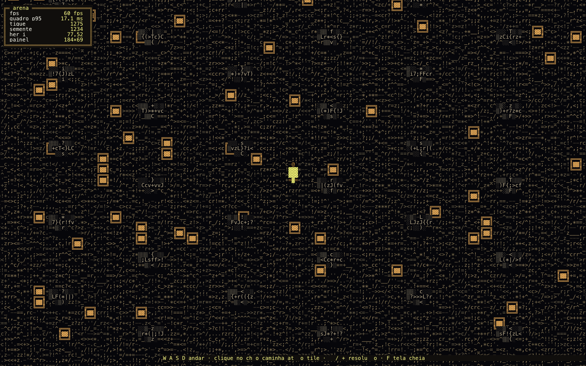

# Isoforge

**Motor de jogos isométricos 2:1 em arte de texto**, para o browser. Roda offline
abrindo um arquivo, sem dependência, sem bundler, sem servidor. A tela é uma grade
de caracteres com cor por célula — não há canvas nem imagem em lugar nenhum.



*`examples/arena` — o jogo de exemplo, ~200 linhas em um arquivo, com tiles de 8×2
células. A mesma build desenharia a cripta, com tiles de 10×3.*

## Por que texto

Medido nesta base, mesma grade de 214×69 células (14.766 células), mesma fonte:

| rota | p50 | p95 |
|---|---|---|
| DOM: linhas de texto com corridas de cor | **2,1 ms** | **3,9 ms** |
| canvas: atlas de glifos × cores (14.766 blits) | 9,4 ms | 49,4 ms |

O caminho de texto é 4× mais rápido na mediana e 12× no p95. Não é compromisso
estético: é a rota mais barata. E o custo real nunca é desenhar — é o que o
navegador parseia e re-layouta.

## O que é

- Projeção 2:1 fixa: **a tela nunca rotaciona**, uma orientação de tile para o jogo inteiro.
- Simulação determinística a passo fixo de 60 Hz: mesma semente + mesma entrada = mesmo hash de estado.
- **Rotas por A\* com custos inteiros**: clique atrás de parede é contornado, destino
  bloqueado vai para o piso ao lado, e a mesma pergunta dá sempre a mesma rota.
- Motor e jogo separados: este repositório é o motor; os jogos vendoram `dist/`.
- 43 invariantes verificadas em um Chromium de verdade, com controle negativo.

## O que não é

- Não é editor de tiles nem ferramenta visual: a arte é código (ou dado) que você escreve.
- Não tem física, pathfinding nem netcode. Há locomoção com colisão por eixo e câmera que segue; A* e uma camada de entidades mais rica são do jogo.
- Não é 3D e não aceita rotação de câmera — é a limitação que compra a simplicidade.

## Começar

```sh
python3 build.py                    # motor -> dist/isoforge.engine.js + .css + release.json
python3 build.py --example arena    # motor + jogo num arquivo -> examples/arena/arena.html
open examples/arena/arena.html      # dois cliques no Finder também funciona
```

O build valida a sintaxe com `node --check` (erro de sintaxe dentro do arquivo único
falha **em silêncio** no browser: página em branco, console vazio) e **morre** se a
saída ganhar `<canvas>`, `data:image`, `http://` ou import de módulo. Texto e
offline são requisito, não preferência — e requisito que não vira asserção de build
vira regressão silenciosa.

O artefato é um script simples, e não um módulo ES, porque `file://` recusa imports
(CORS) e o jogo tem de abrir com dois cliques.

## Usar num jogo

Um jogo consome o motor **vendorando o release** (sem gerenciador de pacote, sem
rede). A receita de oito passos e a API completa estão em
[`docs/engine.md`](docs/engine.md):

```js
Isoforge.configure({ tileCellsW: 10, tileCellsH: 3, wallHeightCells: 4 });

var grid  = Isoforge.grid.createGrid(64, 64);           // 1. mundo
var scene = { grid: grid, entities: [], step: step };   // 2. cena (a sua simulação)
var renderer    = Isoforge.text.createTextRenderer(document.getElementById("screen"));
var hudRenderer = Isoforge.text.createTextRenderer(document.getElementById("hud"), { bleed: 0 });
var view = Isoforge.view.createWorldView(renderer, art);   // 3. arte: tabela de callbacks
var hud  = Isoforge.hud.createHud(hudRenderer, layout);    // 4. painéis: dados
var loop = Isoforge.loop.createLoop({ step: step, render: render });
window.ISO = Isoforge.createContract({ /* o contrato de teste, validado no boot */ });
```

A view recebe uma **tabela de callbacks** (piso, bloco, props, entidades, cursor) e o
HUD uma **descrição de painéis**. O motor conhece a ordem de desenho, o culling e a
grade; nunca a arte. A regra que decide onde cada arquivo mora: *se eu apagar o jogo,
isto ainda faz sentido?* Se sim, é motor.

```
src/core/       config (geometria é parâmetro), rng, iso (projeção + malha do quadro), loop, persist
src/render/     text_renderer (a grade), world_view (ordem de desenho + culling)
src/sim/        grid (o mundo), actor (locomoção), headless (invariantes sem browser)
src/ui/         hud (painéis em box-drawing)
src/engine.js   a superfície pública + o contrato de teste
examples/arena/ um jogo completo em um arquivo
dist/           o release: engine.js, engine.css, VERSION, release.json (hashes)
tools/          a auditoria
docs/engine.md  referência da API e armadilhas medidas
```

## Auditoria

```sh
pip install playwright && playwright install chromium
python3 tools/audit_engine.py                      # 43 checagens no jogo de exemplo
python3 tools/audit_engine.py --html cripta.html   # roda em QUALQUER jogo do motor
python3 tools/audit_engine.py --negative-control   # +1 checagem: prova que a de rigidez pode falhar
```

Um Chromium de verdade, porque ritmo de quadro, layout de texto, `localStorage` em
`file://` e o custo de reescrever uma grade de 15 mil células não se medem em outro
lugar. As invariantes: projeção ida-e-volta com erro zero em 2000 amostras,
determinismo (2 rodadas de 600 passos com o mesmo hash), emenda do loop (passo 600 ≡
passo 0), culling exato (desenhado == geométrico, sem furo), quadro parado escrevendo
**zero** bytes no DOM, 60 fps com zero engasgo, malha rígida sob movimento da câmera,
rolagem suave com deslocamento em células inteiras, arte estável (o mesmo tile pinta
as mesmas células), HUD que não viaja com o mundo, cópia do jogo desenhável pelo
conjunto de glifos, e o release declarado no arquivo batendo com o manifesto.

`--negative-control` quebra a malha numa cópia da página e **exige** que a checagem
de rigidez falhe ali. Um teste que nunca falhou não prova nada.

A auditoria fala só com `window.ISO`, o contrato de teste que o motor **valida no
boot** (faltando membro, o jogo nem sobe). É isso que a torna reusável: ela não
conhece as entranhas de nenhum jogo.

## Decisões que sustentam o motor

| decisão | por quê |
|---|---|
| texto em vez de canvas | 4× mais rápido na mediana, 12× no p95 (tabela acima) |
| conteúdo numa malha grossa + `transform` | a câmera anda ~42 células/s; reconstruir a grade a cada célula custava 5,5 MB/s de HTML. Agora: 0 reconstruções completas, ~28 KB por quadro |
| HUD como segunda grade, sem transform | na grade do mundo ele deslizava junto e tremia: medido 0 px de deriva do HUD contra 43 px do mundo |
| hash de arte por tile + offset local | com a célula na tela, a textura da pedra fervia a cada passo da malha |
| margem de culling derivada da geometria | margem fixa de 3 tiles estava certa para 10×3 e errada para 8×2 (um tile da borda ficava de fora) |
| `fps` pela mediana do quadro | `1000/frameMs` do último quadro reporta 0 num loop saudável |
| `stop()` cancela o handle do rAF | sem isso, `stop()`+`start()` deixa duas correntes de quadro e o contador dobra (medido: 468 quadros em 5 s) |
| o release tem hash, não só versão | número de versão não prova que os bytes são os que o motor construiu |

## Glifos e cor

Cada célula tem glifo, cor de tinta e cor de fundo, cada uma RGB de 24 bits
(16,7 milhões de combinações, sem limite de 256 cores e sem ANSI: a saída é CSS).
`-1` no fundo significa transparente, e é assim que a camada do HUD deixa o mundo
aparecer entre os painéis. O que limita na prática é o DOM: corrida de cor igual é o
que barateia um quadro, então os jogos quantizam o tom **por tile** e tiram a
variedade do glifo, que é de graça.

O conjunto de glifos cobre ASCII, blocos, box-drawing, marcas, acentos latinos e
hífen/aspas tipográficos. Um caractere sem glifo é substituído por espaço **em
silêncio**, então `Isoforge.text.missingGlyphs(texto)` responde o que não seria
desenhado, e a auditoria varre com ele a cópia que o jogo declara.

## Jogos construídos sobre o motor

- **cripta** — ARPG numa cripta gerada por semente, com vagantes, tochas e pilares.
  Projeto separado que vendoriza `dist/`: 34 KB de motor dentro de 100 KB de jogo.

## Requisitos

- Para rodar: um navegador. Nada mais.
- Para construir: Python 3 (o build é um script) e `node` para a checagem de sintaxe.
- Para auditar: Python 3 com Playwright e o Chromium dele.

## Estado

Motor em **0.7.0**, auditoria **43/43** na arena de exemplo (**44/44** com o controle
negativo). O plano da fase 0 está em
[`docs/plan-fase-0.md`](docs/plan-fase-0.md) e o caminho até um ARPG completo, em
[`docs/roadmap-arpg.md`](docs/roadmap-arpg.md) — a fase 1 (rotas) já está entregue.

## Licença

A definir: o repositório está público para leitura, mas sem licença explícita. Se você
pretende reusar, abra uma issue.
